

<a href="https://discord.gg/JsFJTB79ZM"></a>

  
  
  

<a href="#how-to-order"></a>

<a href="#featured"></a>

<a href="https://nfgcord.com"></a>

<a href="#products"></a>

  <a href="https://github.com/Trhpruductions/trhai"></a>
  <a href="https://github.com/Trhpruductions/nexdrive-automotive-os"></a>

<a href="#custom-builds"></a>

  <a href="https://discord.gg/JsFJTB79ZM"></a>
  <a href="https://discord.gg/JsFJTB79ZM"></a>
  <a href="https://discord.gg/JsFJTB79ZM"></a>
  <a href="https://discord.gg/JsFJTB79ZM"></a>

<b>LIVE BUILDS</b> &nbsp;·&nbsp; <a href="https://nfgcord.com">Nexus Forge Gaming</a> &nbsp;·&nbsp; <a href="https://retreats-website.retreats-official-website.workers.dev">The Retreats Community</a> &nbsp;·&nbsp; <a href="https://shadowsofruin.com">Shadows of Ruin</a>

<a href="#packages"></a>

<a href="https://discord.gg/JsFJTB79ZM"></a>

<a href="#add-ons"></a>

<a href="https://discord.gg/JsFJTB79ZM"></a>

<b>Full price list as text</b>

| Package | Starting at | Timeline |
| --- | --- | --- |
| Starter | $150 | 1–2 weeks |
| Growth | $750 | 2–6 weeks |
| Enterprise | $2,500 | 1–3 months |

| Add-on service | Price |
| --- | --- |
| Discord bot development | $75+ |
| Website development | $250+ |
| Auto-updater systems | $150+ |
| Database configuration | $150+ |
| Hosting and cloud setup | $100+ |
| UI/UX design | $100+ |
| Ongoing maintenance | $50 / month+ |

| FiveM livery package | Price |
| --- | --- |
| Basic | $5–$10 |
| Standard | $10–$20 |
| Advanced | $20–$40 |
| Premium | $40–$75+ |

| Bot access plan | Price |
| --- | --- |
| Monthly access | $30 / month |
| Full buyout (source code) | $499 one-time |

<a href="#how-to-order"></a>

<a href="https://discord.gg/JsFJTB79ZM"></a>

<a href="#toolkit"></a>


<a href="https://discord.gg/JsFJTB79ZM"></a>

© 2026 TRH Development &nbsp;·&nbsp; Prices are starting points — every quote is confirmed in your ticket.

